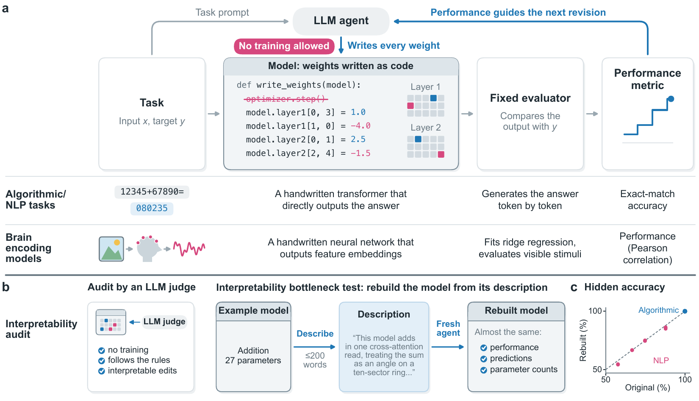

<h1 align="center">Interpretable weight-space programming builds transparent transformers and brain encoding models</h1>

<p align="center">Yash&nbsp;Mehta<sup>1,2</sup> &nbsp;·&nbsp; Chandan&nbsp;Singh<sup>1</sup> &nbsp;·&nbsp; Weijia&nbsp;Xu<sup>1</sup> &nbsp;·&nbsp; Richard&nbsp;J.&nbsp;Antonello<sup>3</sup> &nbsp;·&nbsp; Adeen&nbsp;Flinker<sup>4</sup> &nbsp;·&nbsp; Nima&nbsp;Mesgarani<sup>3</sup> &nbsp;·&nbsp; Michael&nbsp;F.&nbsp;Bonner<sup>2</sup> &nbsp;·&nbsp; Nebojsa&nbsp;Jojic<sup>1</sup> &nbsp;·&nbsp; Jianfeng&nbsp;Gao<sup>1</sup></p>

<p align="center"><sup>1</sup>&nbsp;&nbsp;Microsoft Research &nbsp;&nbsp;&nbsp; <sup>2</sup>&nbsp;&nbsp;Johns Hopkins University &nbsp;&nbsp;&nbsp; <sup>3</sup>&nbsp;&nbsp;Columbia University &nbsp;&nbsp;&nbsp; <sup>4</sup>&nbsp;&nbsp;New York University</p>

<p align="center">
  <a href="https://arxiv.org/abs/2611.18114"></a>
  <a href="https://csinva.io/weight-space-programming-autoresearch/analyze/toy_examples/report.html"></a>
  <a href="#citation"></a>
</p>

<p align="center"></p>

## Overview

Neural networks predict well but are hard to understand, which is a serious problem in science, where explanation is the goal. Encoding models in neuroscience can predict brain responses to natural stimuli, yet they struggle to say which features of the stimulus drive those responses.

**Interpretable weight-space programming (iWSP)** takes a different route: an LLM agent builds the model by writing its weights and features directly in code, and training is not allowed. At each iteration the agent sees only a single validation score, so it has to use what it already knows. It writes interpretable features, reuses known ones, scores them and revises them. The result is a model you can read, because every part of it was written on purpose.

This repo holds the code, agent prompts and full logs behind the [paper](https://arxiv.org/abs/2611.18114).

## Results

| Domain | What iWSP built | Result in the paper |
| --- | --- | --- |
| Algorithmic tasks | Hand-written transformers for tasks such as addition, sorting and GCD | All 26 Opus runs reach 100% accuracy on the hidden set |
| NLP tasks | Hand-written transformers for classification | 87.3% on TREC; well above a majority baseline on 3 of 4 tasks, with no gain on paraphrase detection |
| Visual cortex | Encoding models of 7 T fMRI (LAION-fMRI), tested zero-shot on NSD | Beats all seven interpretable baselines on NSD in early (0.443 versus 0.400) and ventral visual cortex (0.317 versus 0.256); matches AlexNet in early visual cortex and trails it in ventral (0.391) |
| Story-listening fMRI | Encoding models of language responses | A readable model exposed a confound at the edges of each scan: position features alone lift the correlation from 0.067 to 0.104, above GPT-2 XL (0.079). With the edges trimmed, iWSP is on par with GPT-2 XL |
| ECoG responses to audio | Interpretable raw-waveform features | 0.074 versus 0.082 for Whisper on the hidden set, above textbook features (0.059); combining iWSP with Whisper reaches 0.087 |

The models also hold up to a direct test of readability. An LLM describes each model in at most 200 words, and fresh sessions rebuild it from that description alone. All rebuilt models of the 13 algorithmic tasks reach 100% hidden accuracy, and rebuilt NLP models lose about 1.4 points of hidden accuracy on average.

These findings point to iWSP as a way to align highly predictive scientific models with human-interpretable scientific theories.

## Quickstart

You need [uv](https://docs.astral.sh/uv/) and, to run the agent, [Claude Code](https://claude.com/claude-code).

```bash
git clone https://github.com/csinva/weight-space-programming-autoresearch
cd weight-space-programming-autoresearch
uv sync
```

Run the agent on one task. It writes a transformer's weights by hand, scores them and iterates:

```bash
uv run experiments/evolve/launch_claude.py --model opus55 --tasks gcd-three-digits --seeds 1 --workers 1
```

Each run gets its own folder, such as `experiments/runs/opus55/gcd-three-digits-opus55-s1/`, with every model it tried and the agent's transcript. To see the evaluator work without an agent:

```bash
uv run experiments/evolve/setup_run.py demo
cd experiments/runs/manual/demo
uv run interpretable_transformer.py --task addition-five-digits
```

## Reproducing the experiments

| Experiment | Where | Details |
| --- | --- | --- |
| Algorithmic and language transformers | `experiments/evolve/` | [Experiments guide](experiments/README.md#transformers) |
| Text bottleneck | `experiments/nl-bottleneck/` | [Experiments guide](experiments/README.md#text-bottleneck) |
| Story-listening fMRI | `experiments/evolve-neuro/` | [Experiments guide](experiments/README.md#story-listening-fmri) |
| Visual cortex | `experiments/vision/` | [Its README](experiments/vision/README.md) |
| ECoG responses to audio | `experiments/ecog/` | [Experiments guide](experiments/README.md#ecog) |
| Reading a real model's weights | `experiments/systematic-tests/` | [Experiments guide](experiments/README.md#reading-weights) |

## Repository layout

```
experiments/
  evolve/             harness, prompt and audits for the transformer runs
  evolve-neuro/       harness and prompt for the story-listening fMRI runs
  vision/             harness for the visual cortex searches, with its own history
  ecog/               ECoG searches, analyses and new test set results
  nl-bottleneck/      text bottleneck: describe a model, rebuild it, compare
  systematic-tests/   tests of whether an LLM can read a real model's weights
  runs/               every run: opus55, sonnet55, haiku55 and may15 (transformers), neuro (story fMRI)
analyze/              reports and figures built from the runs
```

The [hosted reports](https://csinva.io/weight-space-programming-autoresearch/analyze/toy_examples/report.html) cover the runs in more depth. Runs live in folders and do not use commits, so every model an agent tried is saved as a snapshot next to its logged score.

## Acknowledgements

This work is pretty similar to [Sparks of Weight-Space Programming](https://rikiyat.github.io/blog/weight-space-programming/)! We were working on it at the same time, but a little more focused on the interpretability angle and applying it to neuroscience.

## Citation

If you use this code, please cite the [paper](https://arxiv.org/abs/2611.18114) (also in [`citation.bib`](citation.bib)):

```bibtex
@misc{mehta2026interpretableweightspaceprogrammingbuilds,
      title={Interpretable weight-space programming builds transparent transformers and brain encoding models}, 
      author={Yash Mehta and Chandan Singh and Weijia Xu and Richard J. Antonello and Adeen Flinker and Nima Mesgarani and Michael F. Bonner and Nebojsa Jojic and Jianfeng Gao},
      year={2026},
      eprint={2611.18114},
      archivePrefix={arXiv},
      primaryClass={cs.CE},
      url={https://arxiv.org/abs/2611.18114}, 
}
```
